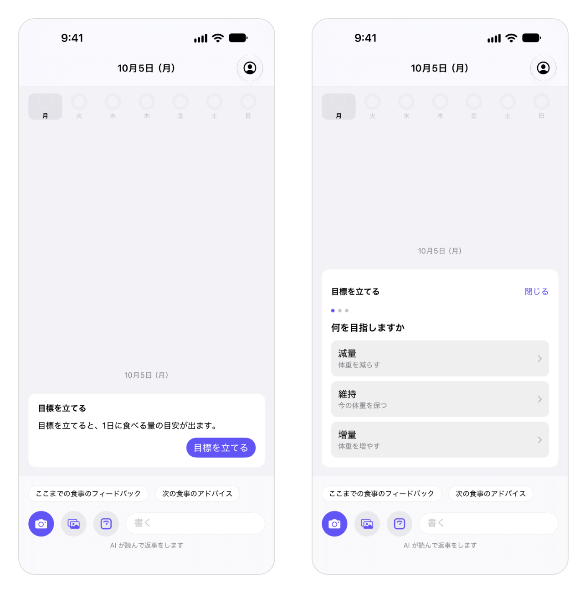
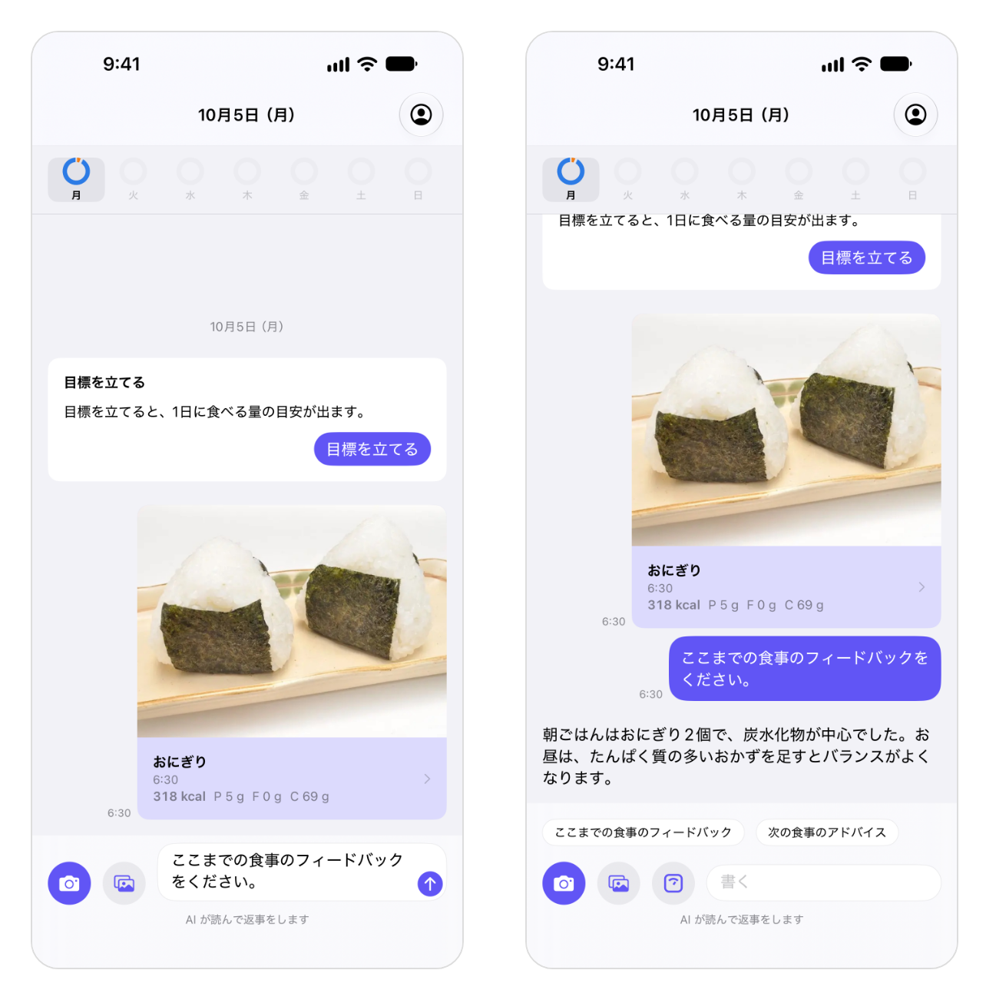
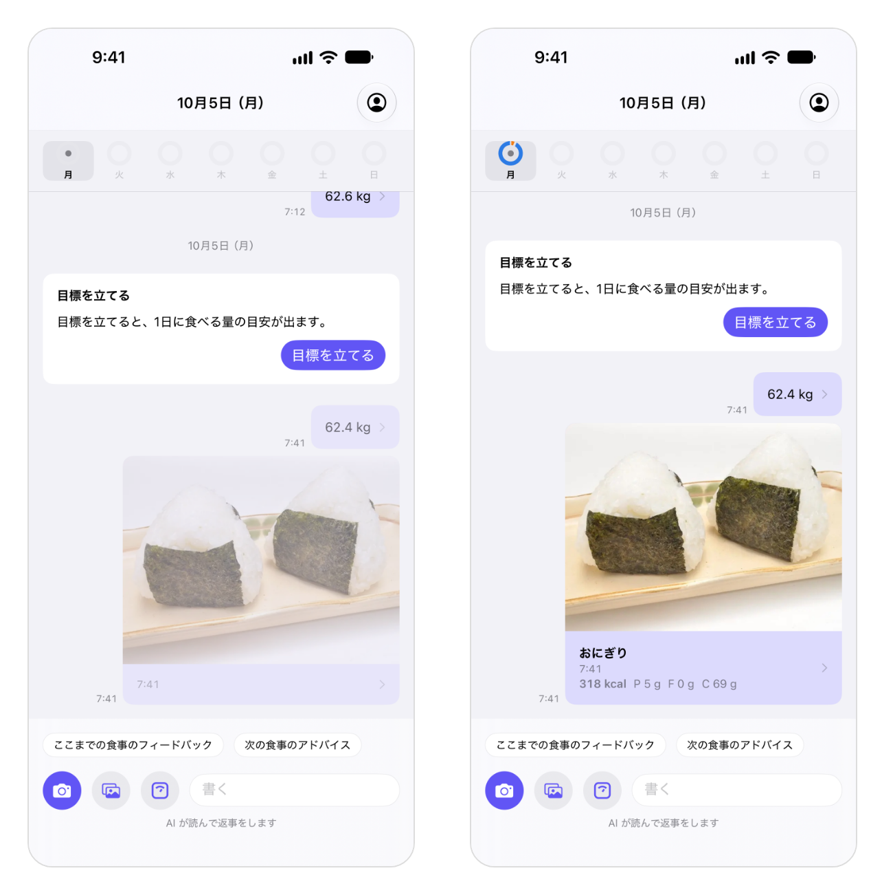

個人開発のアプリではUIデザインを自分で決めることになります。HIGのようなガイドラインに従ったり、AIエージェントのデザインスキルを活用したりすることで、使う人を困らせない、正しいデザインに近づけることができます。

しかし、ガイドライン同士はぶつかることがあります。たとえば、次の2つはどちらも正しいガイドラインです。

- ユーザーの手間を減らす
- 正確な値を記録する

値を推定して自動で埋めれば手間は減りますが、正確さは落ちます。どちらを取るべきかは、**誰のためのアプリかによって変わります**。

この記事では、ガイドラインに順位を付けて、アプリの意図を表す手法を紹介します。順位を付けると、ガイドライン同士がぶつかったときにどちらを取るかが決まり、そのアプリの意図を表した方針ができます。具体例として、先日公開した個人開発アプリ「nu-tori」で方針が判断を決めた場面を3つ取り上げ、正しいだけでなく、意図のあるデザインにするには何が必要かを考えます。

https://nu-tori.app/

nu-toriは写真で食事を記録し、体重の傾向から、その日に摂るカロリーの目安を調整するiPhoneアプリです。この記事では、この目安を「1日の目安」と呼びます。

## ガイドラインに順位を付けると、方針ができる

ガイドラインは、1つずつ取り出せばどれも正しいものです。「ユーザーの手間を減らす」に反対する人はいません。なので、ガイドラインを並べただけでは、アプリごとの違いは出ません。

違いが出るのは、2つのガイドラインがぶつかったときです。nu-toriでよくぶつかるのも、導入で挙げた「ユーザーの手間を減らす」と「正確な値を記録する」です。正確に記録しようとすると、食材の重さを量ったり推定を確かめたりと、ユーザーの手間が増えます。nu-toriは手間の少なさを取りました。でも、栄養を細かく管理したい人向けのアプリなら、手間をかけてでも正確さを取るのが正解でしょう。

このように、**反対の立場もまともに成り立つところで、どちらを取るかを決めたもの**が、そのアプリの方針です。こうした方針は「デザインプリンシプル」とも呼ばれます。

方針を1つずつ書き出すのは大変なので、nu-toriではガイドラインに順位を付けておき、2つがぶつかったら上のほうを取ることにしました。8つのガイドラインから、ぶつかる組み合わせの数だけ方針が生まれる、という関係です。

nu-toriのガイドラインは、すでにあるガイドラインから選んだものではありません。AIエージェントにインタビューしてもらいながら、私がこのアプリで大事にしたいことを言葉にしていき、できあがったのが次の8つです。

1. **ユーザーの操作を増やさない**: いちばんよく起こる使い方に合わせて、最短で操作できるようにする
2. **先回りして気を利かせる**: システムでわかることは、ユーザーに尋ねない
3. **正確に測れる値は、正確に入れてもらう**: ユーザーが測れば正確にわかる値は、手間がかかっても入れてもらう
4. **仕組みを言い訳にしない**: 「間違うかもしれない」という言い訳を画面に出さない
5. **求められていないことは言わない**: アドバイスは尋ねられたときだけ出す
6. **モードレス**: どの操作も途中でやめられ、あとからやり直せる
7. **専用の画面より、小さな機能の組み合わせ**: 特定の作業のための画面を作らず、小さな機能を組み合わせて使えるようにする
8. **拡張性**: ほかのアプリとの連携、写真以外の記録方法を、今の構造を壊さずに足せるようにしておく

どれも、よく言えば正しいことですが、悪く言うこともできます。「操作を増やさない」は正確さを犠牲にすることでもあり、「先回りして気を利かせる」は余計なお世話にもなります。悪い面があるからほかのガイドラインとぶつかり、ぶつかるから順位が必要です。

順位を付けるときは、**アプリでいちばん守りたい場面を1つ決め、その場面で手間取らせないものを上に置きました**。nu-toriでは「食べる前にさっと撮る」場面です。食事の記録は1日に何度も起きるので、1回あたりの手間の差がいちばん大きく響きます。

この場面を選んだのは、以前ほかの食事管理アプリを使っていたときに、ここでつまずいたからです。食事の写真を撮ったあとに推定を待ち、「これでいいですか？」にOKするまで記録が確定しませんでした。そのあいだは食べ始められません。写真だけ撮っておいて、時間があるときにアップロードする方法もありましたが、その「時間があるとき」はなかなか来ず、記録を忘れてしまいました。nu-toriでは、食事の時刻は写真の撮影時刻を使い、料理や量は推定で埋めるので、写真を撮ったあとにユーザーに尋ねることはありません。「操作を増やさない」と「先回りして気を利かせる」を1位と2位に置いたのは、この場面で手間取らせないためです。

## 方針が判断を決めた場面

ここからは、nu-toriで方針が判断を決めた場面を3つ取り上げます。どれも、ガイドラインだけでは答えが決まらず、順位を見て決めたものです。

nu-toriの画面の中心は、1つのタイムラインです。食事や体重の記録と、アプリからの知らせが日ごとに並びます。画面の下には入力欄があり、写真を撮る、写真を選ぶ、体重を入れる、AIに書いて尋ねる、のどれもここから始めます。

### オンボーディングで、体重や目標の入力を求めない

私が使ってきた食事管理アプリの多くは、オンボーディングで体重や目標を入れ終えるまで、ほかの操作ができませんでした。1日の目安は体重と目標から出すので、最初にそろえてもらうのは理にかなったデザインです。nu-toriも3位に「正確に測れる値は、正確に入れてもらう」を置いていて、体重はなるべく毎日、体重計で測った値を入れてもらいます。

ただ、それは目標を立てることから始めたい人に合わせた順番です。アプリを入れたばかりの人がまずやりたいことは、ほかにもあると思っています。たとえば、食事の写真を撮るだけで本当に栄養がわかるのかを確かめることです。手元にある食べ物や、パッケージの栄養成分表示を試しに撮ってみて、「これだけでわかるのか」と感じるところまでを、すぐに試せてほしいのです。どちらから始めたい人もいるはずで、**その順番をアプリが決めて押しつけるべきではない**、と私は考えています。

そこでnu-toriでは、オンボーディングで体重や目標を求めず、サインインしたらすぐにタイムラインに入るようにしました。先に体重や目標を入れてもらう流れは、写真を試したい人にとっては、栄養を確かめるまでの操作を増やすからです。目標を立てたい人には、まだ目標がないことをタイムラインで伝え、そこからすぐに立ててもらいます。ここで判断を決めたのは、1位の「操作を増やさない」を3位より上に置いたことから出てくる、「ユーザーが興味のあるものから試せるようにする」という方針です。そのぶん、体重と目標がそろうまで、1日の目安は出ません。

目標の設定を、画面を切り替えるシートで出すか、タイムラインのカードを広げてその場で進めるかでも迷いました。HIGを調べると、どちらの形もガイドラインに合っていて、優劣は決まっていませんでした。決め手になったのは、6位の「モードレス」（どの操作も途中でやめられ、あとからやり直せる）で、カードの中で進める形にしました。カードを広げているあいだも、タイムラインと入力欄はそのまま使えます。

一方で、毎朝の体重は求めます。「操作を増やさない」は、操作をなくすことではなく、よく起こる操作を最短にすることです。体重を入力することは、食事の写真を撮ることと並んで、nu-toriがユーザーに求める2つの操作の1つです。体重の値は1日の目安のもとになるからです。「正確に測れる値は、正確に入れてもらう」に沿って毎朝測った値を入れてもらうので、ユーザーには毎朝の手間を強いることになりますが、そこは割り切っています。そのかわり、「先回りして気を利かせる」に沿って、ふだん体重を入れている時刻を過ぎても記録がないときだけ知らせ、ヘルスケアからその日の体重が入っていれば知らせないようにしています。

### 記録のたびにアドバイスを出さない

食事管理アプリには、記録するたびにアドバイスを出すものがあります。有料プランの機能になっていることもあり、喜ぶ人がいるのは確かです。食べたものにすぐ反応が返ってくれば、記録を続ける励みにもなります。

nu-toriでも、毎食後にひとことフィードバックを出し、習慣化を支える仕組みにするデザインを検討したことがありました。習慣化は大事なので、もっともらしく見えます。でも、5位の「求められていないことは言わない」に反します。とはいえ、習慣化に役立ちそうな点は捨てがたいものでした。ここで判断を決めたのは、5位と7位の「専用の画面より、小さな機能の組み合わせ」を合わせた、「アドバイスは自分からは出さず、いつもの入力欄から気軽に尋ねられるようにする」という方針です。**アドバイスのための専用のボタンや画面は作らず**、もともとある「AIに書いて尋ねる」入力欄に、「ここまでの食事のフィードバック」「次の食事のアドバイス」というプリセットを並べました。押すと入力欄にその文が入り、送れば、自分で書いて尋ねたときと同じように返事が来ます。書くのが面倒な人も、押して送るだけで尋ねられます。アドバイスが必要ない人は、淡々と記録だけできます。

### サーバーを待たずに、操作をすぐ受け付ける

nu-toriの推定や返事はサーバーで作ります。作る側にとっていちばん手軽なのは、操作のたびにサーバーへ送り、返事が来てから画面を進める作り方です。電波がなければ「接続を確認してください」と出して止めます。

でもそうすると、ユーザーは操作のたびに返事を待つことになります。電波が弱ければ待ち時間は延び、つながらなければその場で止まります。nu-toriでは、電波が強くても弱くても、操作した瞬間に画面が応え、そのまま次の操作に移れるようにしたいと考えました。返事を待つあいだ操作を止めるのは、6位の「モードレス」に反しますし、失敗したら送り直してもらうのは、1位の「操作を増やさない」に反します。8つのガイドラインはどれもユーザーの体験のためのもので、作る側の手間を減らすためのものはありません。**システムで引き受けられる複雑さは、できるかぎりシステムで引き受けます**。ここで判断を決めたのは、「電波にかかわらず、いつでもサクサク操作できるようにすることに手間をかける」という方針です。

そこでnu-toriでは、ユーザーの操作をまず端末の記録に書き、すぐ画面に出すようにしました。サーバーとの同期は、バックグラウンドで進めます。オフラインファーストと呼ばれる作り方で、電波がないときも、ほとんどの操作はいつもどおりできます。

その手間は小さくありませんでした。端末のキャッシュとサーバーの差分同期、端末で作った書き込みを順に送る送信キュー、同じ書き込みが何度届いても結果が変わらないようにする冪等性の担保、競合の解決を用意しています。

## 作らないものを決めると、意図のあるデザインになる

ガイドラインやデザインスキルに沿えば、正しい機能を作るのは難しくありません。AIエージェントのおかげで作る手間は下がり、個人開発なら作るかどうかも自分ひとりで決められます。

正しい機能がたくさんあること自体は、悪いことではありません。ただ、正しい機能は、それぞれ誰かにとって正しいものです。手間と正確さの図で比べたように、栄養を細かく管理したい人向けのアプリなら、手間をかけてでも正確さを取るのが正解です。なので、機能を1つずつ正しくするだけでは、特定の誰かのためのアプリにはなりません。

nu-toriは、手間なく記録したい人に向けたアプリです。オンボーディングで最初に体重と目標を求めることも、食後にひとことを出すことも、理にかなった案でした。でも、最初の入力は食事の写真を撮るまでの操作を増やし、食後のひとことは、ただ記録したい人にとっては求めていない言葉です。どちらも作らなかったので、写真を試したい人はすぐに写真を撮れ、記録だけしたい人は淡々と記録を続けられます。

方針があると、何を作り、何を作らないかを決められます。機能の組み合わせを考え、**ときには意図して機能をなくすことで、正しいだけでなく、意図のあるデザインになります**。
