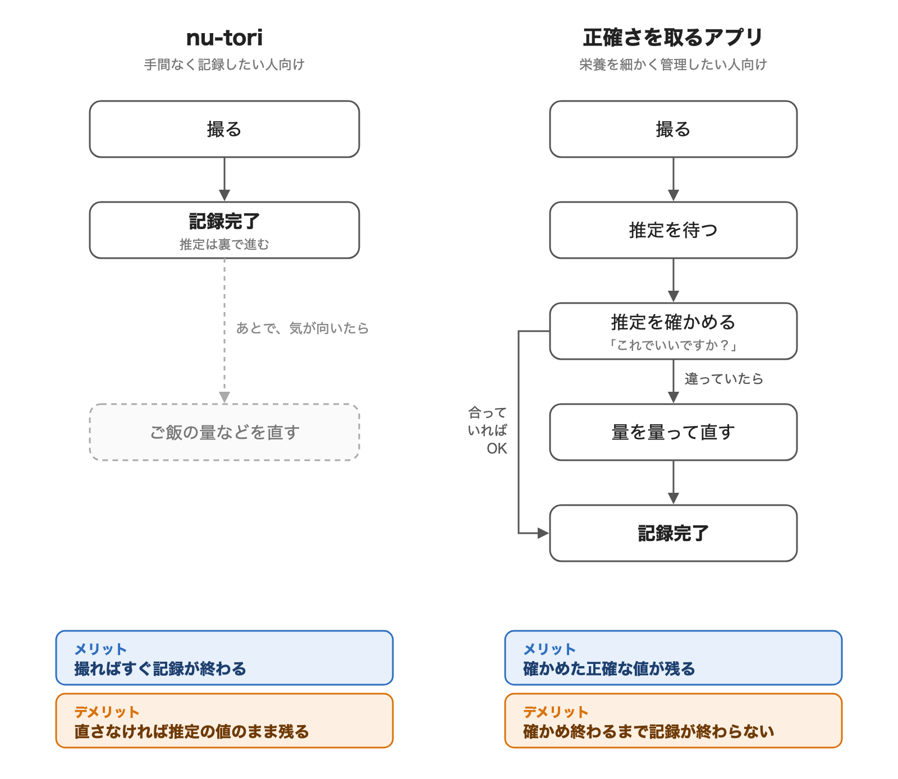

個人開発のアプリではUIデザインを自分で決めることになります。HIGのようなガイドラインに従ったり、AIエージェントのデザインスキルを活用したりすることで、使う人を困らせない、正しいデザインに近づけることができます。

しかし、ガイドライン同士はぶつかることがあります。たとえば、次の2つはどちらも正しいガイドラインです。

- 取り消せない操作の前には確認を挟む
- ユーザーの手間を減らす

では、記録を削除するときに確認を挟むべきでしょうか。どちらを取るべきかは、**誰のためのアプリかによって変わります**。

この記事では、ガイドラインに順位を付けて、アプリの意図を表す手法を紹介します。順位を付けると、ガイドライン同士がぶつかったときにどちらを取るかが決まり、そのアプリの意図を表した方針ができます。具体例として、先日公開した個人開発アプリ「nu-tori」で方針が判断を決めた場面を3つ取り上げ、正しいだけでなく、意図のあるデザインにするには何が必要かを考えます。

https://nu-tori.app/

nu-toriは写真で食事を記録し、体重の傾向から、その日に摂るカロリーの目安を調整するiPhoneアプリです。この記事では、この目安を「1日の目安」と呼びます。

## ガイドラインに順位を付けると、方針ができる

ガイドラインは、1つずつ取り出せばどれも正しいものです。「ユーザーの手間を減らす」に反対する人はいません。なので、ガイドラインを並べただけでは、アプリごとの違いは出ません。

違いが出るのは、2つのガイドラインがぶつかったときです。nu-toriでよくぶつかるのは、「ユーザーの手間を減らす」と「正確な値を記録する」です。正確に記録しようとすると、食材の重さを量ったり推定を確かめたりと、ユーザーの手間が増えます。nu-toriは手間の少なさを取りました。でも、栄養を細かく管理したい人向けのアプリなら、手間をかけてでも正確さを取るのが正解でしょう。

このように、**反対の立場もまともに成り立つところで、どちらを取るかを決めたもの**が、そのアプリの方針です。こうした方針は「デザインプリンシプル」とも呼ばれます。

方針を1つずつ書き出すのは大変なので、nu-toriではガイドラインに順位を付けておき、2つがぶつかったら上のほうを取ることにしました。8つのガイドラインから、ぶつかる組み合わせの数だけ方針が生まれる、という関係です。

nu-toriのガイドラインは、すでにあるガイドラインから選んだものではありません。AIエージェントにインタビューしてもらいながら、私がこのアプリで大事にしたいことを言葉にしていき、できあがったのが次の8つです。

1. **ユーザーの操作を増やさない**: 精度を上げる操作は、いつでもできるが、しなくてよい
2. **先回りして気を利かせる**: システムが知りうることは、ユーザーに尋ねる前に使う
3. **正確に測れる値は、正確に入れてもらう**: ユーザーが測れば正確にわかる値は、推定で埋めずに入れてもらう
4. **仕組みを言い訳にしない**: 「間違うかもしれない」という言い訳を画面に出さない
5. **求められていないことは言わない**: アドバイスは尋ねられたときだけ出す
6. **モードレス**: どの操作も途中でやめられ、あとからやり直せる
7. **専用の画面より、小さな機能の組み合わせ**: 特定の作業のための画面を作らず、小さな機能を組み合わせて使えるようにする
8. **拡張性**: ほかのアプリとの連携、写真以外の記録方法を、今の構造を壊さずに足せるようにしておく

どれも、よく言えば正しいことですが、悪く言うこともできます。「操作を増やさない」は正確さを犠牲にすることでもあり、「先回りして気を利かせる」は余計なお世話にもなります。悪い面があるからほかのガイドラインとぶつかり、ぶつかるから順位が必要です。

順位を付けるときは、**アプリでいちばん守りたい場面を1つ決め、その場面で手間取らせないものを上に置きました**。nu-toriでは「食べる前にさっと撮る」場面です。食事の記録は1日に何度も起きるので、1回あたりの手間の差がいちばん大きく響きます。

この場面を選んだのは、以前ほかの食事管理アプリを使っていたときに、ここでつまずいたからです。食事の写真を撮ったあとに推定を待ち、「これでいいですか？」にOKするまで記録が確定しませんでした。そのあいだは食べ始められません。写真だけ撮っておいて、時間があるときにアップロードする方法もありましたが、その「時間があるとき」はなかなか来ず、記録を忘れてしまいました。nu-toriでは、食事の時刻は写真の撮影時刻を使い、料理や量は推定で埋めるので、写真を撮ったあとにユーザーに尋ねることはありません。「操作を増やさない」と「先回りして気を利かせる」を1位と2位に置いたのは、この場面で手間取らせないためです。

## 方針が判断を決めた場面

ここからは、nu-toriで方針が判断を決めた場面を3つ取り上げます。どれも、ガイドラインだけでは答えが決まらず、順位を見て決めたものです。

nu-toriの画面の中心は、1つのタイムラインです。食事や体重の記録と、アプリからの知らせが日ごとに並びます。画面の下には入力欄があり、写真を撮る、写真を選ぶ、体重を入れる、AIに書いて尋ねる、のどれもここから始めます。

### オンボーディングで、体重や目標の入力を求めない

私が使ってきた食事管理アプリの多くは、オンボーディングで体重や目標を入れ終えるまで、ほかの操作ができませんでした。1日の目安は体重と目標から出すので、最初にそろえてもらうのは理にかなったデザインです。nu-toriも3位に「正確に測れる値は、正確に入れてもらう」を置いていて、体重はなるべく毎日、体重計で測った値を入れてもらいます。

ただ、それは目標を立てることから始めたい人に合わせた順番です。アプリを入れたばかりの人がまずやりたいことは、ほかにもあると思っています。たとえば、食事の写真を撮るだけで本当に栄養がわかるのかを確かめることです。手元にある食べ物や、パッケージの栄養成分表示を試しに撮ってみて、「これだけでわかるのか」と感じるところまでを、すぐに試せてほしいのです。どちらから始めたい人もいるはずで、**その順番をアプリが決めて押しつけるべきではない**、と私は考えています。

そこでnu-toriでは、オンボーディングで体重や目標を求めず、サインインしたらすぐにタイムラインに入るようにしました。先に体重や目標を入れてもらう流れは、写真を試したい人にとっては、栄養を確かめるまでの操作を増やすからです。目標を立てたい人には、まだ目標がないことをタイムラインで伝え、そこからすぐに立ててもらいます。ここで判断を決めたのは、1位の「操作を増やさない」を3位より上に置いたことから出てくる、「ユーザーが興味のあるものから試せるようにする」という方針です。そのぶん、体重と目標がそろうまで、1日の目安は出ません。

目標の設定を、画面を切り替えるシートで出すか、タイムラインのカードを広げてその場で進めるかでも迷いました。HIGを調べると、どちらの形もガイドラインに合っていて、優劣は決まっていませんでした。決め手になったのは、6位の「モードレス」（どの操作も途中でやめられ、あとからやり直せる）で、カードの中で進める形にしました。カードを広げているあいだも、タイムラインと入力欄はそのまま使えます。

一方で、毎朝の体重は求めます。「操作を増やさない」で求めないとしているのは、精度を上げるための操作です。体重を入力することは、食事の写真を撮ることと並んで、nu-toriがユーザーに求める2つの操作の1つです。体重の値は1日の目安のもとになるからです。「正確に測れる値は、正確に入れてもらう」に沿って毎朝測った値を入れてもらうので、ユーザーには毎朝の手間を強いることになりますが、そこは割り切っています。そのかわり、「先回りして気を利かせる」に沿って、ふだん体重を入れている時刻を過ぎても記録がないときだけ知らせ、ヘルスケアからその日の体重が入っていれば知らせないようにしています。

### 記録のたびにアドバイスを出さない

食事管理アプリには、記録するたびにアドバイスを出すものがあります。有料プランの機能になっていることもあり、喜ぶ人がいるのは確かです。食べたものにすぐ反応が返ってくれば、記録を続ける励みにもなります。

nu-toriでも、毎食後にひとことフィードバックを出し、習慣化を支える仕組みにするデザインを検討したことがありました。習慣化は大事なので、もっともらしく見えます。でも、5位の「求められていないことは言わない」に反します。とはいえ、習慣化に役立ちそうな点は捨てがたいものでした。ここで判断を決めたのは、5位と7位の「専用の画面より、小さな機能の組み合わせ」を合わせた、「アドバイスは自分からは出さず、いつもの入力欄から気軽に尋ねられるようにする」という方針です。**アドバイスのための専用のボタンや画面は作らず**、もともとある「AIに書いて尋ねる」入力欄に、「ここまでの食事のフィードバック」「次の食事のアドバイス」というプリセットを並べました。押すと入力欄にその文が入り、送れば、自分で書いて尋ねたときと同じように返事が来ます。書くのが面倒な人も、押して送るだけで尋ねられます。アドバイスが必要ない人は、淡々と記録だけできます。

### サーバーを待たずに、操作をすぐ受け付ける

nu-toriの推定や返事はサーバーで作ります。作る側にとっていちばん手軽なのは、操作のたびにサーバーへ送り、返事が来てから画面を進める作り方です。電波がなければ「接続を確認してください」と出して止めます。

でもそうすると、ユーザーは操作のたびに返事を待つことになります。電波が弱ければ待ち時間は延び、つながらなければその場で止まります。nu-toriでは、電波が強くても弱くても、操作した瞬間に画面が応え、そのまま次の操作に移れるようにしたいと考えました。返事を待つあいだ操作を止めるのは、6位の「モードレス」に反しますし、失敗したら送り直してもらうのは、1位の「操作を増やさない」に反します。8つのガイドラインはどれもユーザーの体験のためのもので、作る側の手間を減らすためのものはありません。**システムで引き受けられる複雑さは、できるかぎりシステムで引き受けます**。ここで判断を決めたのは、「電波にかかわらず、いつでもサクサク操作できるようにすることに手間をかける」という方針です。

そこでnu-toriでは、ユーザーの操作をまず端末の記録に書き、すぐ画面に出すようにしました。サーバーとの同期は、バックグラウンドで進めます。オフラインファーストと呼ばれる作り方で、電波がないときも、ほとんどの操作はいつもどおりできます。

その手間は小さくありませんでした。端末のキャッシュとサーバーの差分同期、端末で作った書き込みを順に送る送信キュー、同じ書き込みが何度届いても結果が変わらないようにする冪等性の担保、競合の解決を用意しています。

## 作らないものを決めると、意図のあるデザインになる

ガイドラインやデザインスキルに沿えば、正しい機能を作るのは難しくありません。AIエージェントのおかげで作る手間は下がり、個人開発なら作るかどうかも自分ひとりで決められます。

正しい機能がたくさんあること自体は、悪いことではありません。ただ、正しい機能は、それぞれ誰かにとって正しいものです。手間と正確さの図で比べたように、栄養を細かく管理したい人向けのアプリなら、手間をかけてでも正確さを取るのが正解です。なので、機能を1つずつ正しくするだけでは、特定の誰かのためのアプリにはなりません。

nu-toriは、手間なく記録したい人に向けたアプリです。オンボーディングで最初に体重と目標を求めることも、食後にひとことを出すことも、理にかなった案でした。でも、最初の入力は食事の写真を撮るまでの操作を増やし、食後のひとことは、ただ記録したい人にとっては求めていない言葉です。どちらも作らなかったので、写真を試したい人はすぐに写真を撮れ、記録だけしたい人は淡々と記録を続けられます。

方針があると、何を作り、何を作らないかを決められます。機能の組み合わせを考え、**ときには意図して機能をなくすことで、正しいだけでなく、意図のあるデザインになります**。

<!-- tech-article-state
## 成果物（2026-11-13 全面的に書き直し。それより前の企画・構造・導入の記録はgitの履歴にある）
### 企画
- 読み手: 自分でUIデザインを決めて実装まで行う個人開発者（デザインを自分で決めて実装までやるのはほぼ個人開発者だけ、という開発者の意見）。HIGやAIエージェントのデザインスキルは手元にある
- 型: 解説（案B）。「記事を書こうとして失敗して書き直した」話はメタすぎるので書かない
- 主張: ガイドラインは単体ではどれも正しく、並べるだけではアプリごとの違いは出ない。ガイドラインに順位を付けると、ぶつかったときに「AよりBを取る」方針ができる。方針があると、迷わず決められ判断がそろう／もっともらしい案（AIエージェントのものも）を断れる／限られた手間をかける場所が決まる
- 構造の捉え方（開発者）: 1〜8は独立したガイドラインで、順位を付けることで、ぶつかる組み合わせごとに方針ができる。ガイドラインと方針は1対1に対応しない。方針の見分け方は「反対の立場もまともに成り立つか」
- 8つのガイドラインはどれも「よく言えば／悪く言えば」が言える形にする（例: 操作を増やさない↔正確さを犠牲にする、先回りして気を利かせる↔余計なお世話）。悪く言えばが言えないものは、すでに答えが出た方針になっている。3位は旧「値の確かさに応じて受け付け方を変える」が体重と食事の2つの答えを抱えて悪い面がなかったため、「正確に測れる値は、正確に入れてもらう」に書き直した（悪く言えば毎朝の手間を強いる。割り切り、2位のいつもの時刻に合わせた知らせで軽くする）。ADR-0001の書き方とは異なる
- 「無難→魅力的」の対比は主張の中心から外した（開発者「なかったら無難、あったら魅力的、だけじゃない」）。タイトルは「正しいUIデザインと、意図のあるUIデザイン」（2026-11-13決定）

### 用語
- 一般的なもの＝「ガイドライン」、アプリ固有のもの＝「方針」。「原則」「プリンシプル」は使わない。「デザインプリンシプル」は検索のため本文で1回だけ出す
- nu-toriの8つは「ガイドライン」として扱い、「N位」で呼ぶ

### 構成
- 導入（2026-11-14 開発者が手で書き直し）: 個人開発ではUIデザインを自分で決めることになる→ガイドラインやデザインスキルで「困らせない、正しい」デザインにはできる→ガイドライン同士はぶつかる（確認を挟むか手間を減らすか、箇条書き。場面は記録の削除）→その場で決めると画面ごとにぶれる、アプリで答えが違うのでガイドラインにもAIにも決められない→順位を付けてアプリの意図を表す手法、3つの場面と何がいいのかを予告。LPと紹介。「AIは安全なほうを勧める傾向」は本文に裏付けがないので書かない（2026-11-17、開発者の指摘で、「来るたびにその場で決めると画面ごとにぶれる」をやめ、「記録を削除するときに確認を挟むべきか」という問いと「誰のためのアプリかによって違う」にした。予告の最後は締めの章に合わせ「正しいだけでなく、意図のあるデザインにするには何が必要か」にした）
- 1. ガイドラインに順位を付けると、方針ができる: 「順位を付けるとは／どんなガイドラインか／どうやって順位を付けたか」の3つの問いに順に答える
  - 順位を付けるとは: 手間vs正確さの例（反対も成り立つ、図）、デザインプリンシプル、ぶつかったら上を取る、組み合わせごとに方針
  - どんなガイドラインか: すでにあるものから選んだのではなく、AIエージェントにインタビューしてもらい開発者の大事にしたいことを言葉にした8つ（開発者の説明）。どれも「よく言えば／悪く言えば」が言え、悪い面があるからぶつかる
  - どうやって順位を付けたか: 1位・2位は「食べる前にさっと撮る」場面と過去の体験から。3位以降の並べ方は書かない（最初6つで始め、設計の途中で2つ足したという経緯はnu-toriの04-concept.mdの履歴にあるが、記事の価値が変わらないので開発者の判断で外した）。「2つずつ比べた」は事実か不明なので1節では書かず、最後の節で勧める方法としてだけ出す
  - 1節には子セクションを作らない。短く、1本の論理で進むため、段落の書き出しで3つの問いの区切りを見せる
- 2. 方針が判断を決めた場面
  - オンボーディング: 多くのアプリは最初に体重・目標を入れ終えるまで操作できない（開発者の体験）。3位があっても、先に入れ終えるまで進めない流れは1位（撮るまでの操作が増える）と6位（途中でやめられない）に反するので取らない（6位は3位より下なので「上にあるから」とは書かない）。サインイン→すぐタイムライン、目標は知らせから、許可は要る操作の中で（docs/ui-design/0001-first-release/05-navigation.md）。目標の設定はシートかカードか、HIGでは優劣なし→6位でカード（docs/research/hig-inline-goal-setup.md）。一方で毎朝の体重は求める: 1位が求めないのは精度を上げる操作で、体重は撮ることと並ぶ2つの操作の1つ（04-concept.mdの叩き台の1位、ADR-0001の本文）。3位の毎朝の手間は割り切り、2位でいつもの時刻を過ぎたときだけ知らせる
  - アドバイス: 毎回出すアプリもあり、有料プランの機能のこともある（docs/research/asken-macrofactor.md。競合名は出さない。「うざがられている」根拠はない）。食後のひとこと→5位で尋ねられたときだけ→プリセット。翌日にADR
  - 電波: サーバーで推定するので止めるのが手軽。1位・6位のため同期を自前で（ADR-0013）。作る側の手間はガイドラインに無いが、順位が手間をかける根拠に
- 3. 作らないものを決めると、意図のあるデザインになる（旧「方針を用意すると何がいいのか」、締めの章）: タイトルの回収（2026-11-17、開発者の考え）。ガイドラインやスキル、AIエージェントで正しい機能はたくさん作れ、個人開発では止める人もいない→正しい機能が多いこと自体は悪くないが、正しさは誰のためのアプリかを決めない（手間と正確さの図）→作らないものを決めることは、向ける人と場面を決めること（最初の入力と食後のひとことを作らず、さっと撮る場面が軽いまま残った）→意図のあるデザインになる。「チグハグになる」は、手間をかける場所を選ぶこと自体がこの記事の手法なので使わない。「ガイドラインに照らせば良い案」は根拠がないので書かない。「使う人が先読みできる」は開発者が狙っていないので書かない。見た目を標準の部品にしたのはプラットフォームの作法に従う一般的なガイドラインなので例にしない
- 「自分のアプリで試すなら」の章は消した（2026-11-17）。手順の3つは1章と重なり、エージェントが読む場所に置く話はタイトルと関係なく、「迷ったら意図に戻る」（標準カメラの例）は記事全体で話していることなので、締めの章のあとに置かない
- 外したもの: サインアウトの確認（どのアプリでもそうする）、「AI」と出さない例外（なぜ出さないかから説明が要る）、撮ったら確認せず記録・待つあいだ止めない（旧版の例。必要なら戻せる）、エージェントの保守的な見出しの小ネタ
- 図: 1節の「手間と正確さ」の段落の直後に、記録の流れを並べる図を1枚（images/articles/08568310684aa3/image01.png）。左がnu-tori（手間なく記録したい人向け）、右が正確さを取るアプリ（栄養を細かく管理したい人向け、実在のアプリに寄せない）。右は推定が合っていればOKで終わり、量を量るのは違っていたときだけ。下にメリット（青）とデメリット（オレンジ）。nu-toriを左にしたのは本文の順と同じで、右が「改善後」に見えないようにするため。元のSVGはこのリポジトリにコミットしていない

### 注意
- 食後のひとこと（2026-09-23）はADR-0001（2026-09-24）より前。「この件の翌日に順位をADRに書き出した」まで
- 開発者自身の健康データ、nu-tori-opsの中身、競合の名前、リポジトリのURLは書かない。published: falseのまま
- 全角文字と半角英数字のあいだにスペースを入れない
- 編集の前に必ずpullし、開発者が書き直した文は勝手に言い換えない

## 履歴
- 2026-11-09起動 新規スタート
- 2026-11-10企画 主張をADR-0001に決定。読み手を「エージェントとデザインのスキルでUIを作る個人開発者」に
- 2026-11-11構造 キーライン3本のたたき台。開発者の意見で例を差し替え
- 2026-11-11導入 標準型でSCQAのたたき台。キーラインの最終確認と型の選択待ち
- 2026-11-11構造 開発者の意見で主ポイントを「保守的な案を退ける」から「攻めた案を選ぶ」へ。順位の作り方と「参考情報」の位置づけを直す
- 2026-11-11本文 標準型の導入と本文の初稿。スクリーンショットは「📷 TODO」のコメントで5か所
- 2026-11-11企画 開発者の意見で主張を「エージェント」から「プラクティス×こだわり」へ広げる。導入・締め・リンクを直す
- 2026-11-11推敲前 大枠の流れは確定。次は開発者の細かい指摘と、開発者自身の手書きの書き直し（AI臭さを消すため）。編集の前に必ずpullし、開発者が書き直した文は勝手に言い換えない
- 2026-11-11導入 検索流入のためC先行型に変更。入口にエージェントのスキル、橋に「スキルの中身はプラクティス」。タイトルを開発者の案に
- 2026-11-11導入 デザインのスキルを調べ、藁人形にならないよう1・2段落目を直す（尖らないのは判断、例は実在する規則に）
- 2026-11-11企画 開発者の意見で主張を再改訂。「原則を知っている」と「自分のアプリで何を優先するか決める」を分け、後者はふつうのデザインプロセスの一部として具体例で伝える。順位はエージェントと共有して判断を一貫させる。導入とタイトルはこれから直す
- 2026-11-11構造 原則だけの案とnu-toriの案を並べる表を軸に、全体を5節＋締めに組み替える。導入で「デザインプリンシプル」を紹介。タイトルは仮
- 2026-11-11導入1段落目を開発者の文（「無難」の先の「魅力的」、アプリ固有の価値観）に。開発者の了承で「原則に沿った」「案」の2か所だけ調整。読者は無難さに気づいていない前提なので、悩みを言い当てるのでなく「その先がある」と見せる。2段落目は無難になる理由、3段落目はデザインプリンシプル＋順位の具体化に。タイトルも「UIデザインの原則」を入れる方向で見直す予定
- 2026-11-11 表記 開発者の書き方に合わせ、全角文字と半角英数字のあいだにスペースを入れない（以後も守る）。タイトルを「無難なUIデザインから、魅力的なUIデザインへ」に決定
- 2026-11-11 本文 価値観を決めない問題を「無難になる（1つの判断）／ぶれる（判断のあいだ）／毎回迷う（進め方）」に整理。導入2段落目にぶれを1文、表のあとで「無難」「魅力的」を回収（魅力的＝狙った人の狙った使い方で、ほかより明らかに使いやすい）、締めの手順4に毎回迷わずに済むことを足す
- 2026-11-12 導入 開発者の指摘で2段落目を短く。「無難／ぶれる／毎回迷う」は並列でなく「迷う→ぶれる→安全に寄る」の1本の流れとして1文に。先に決めておけば判断がそろい、AIも沿った案を出す、で締める
- 2026-11-13 全面書き直し 開発者の意見で、読み手を個人開発者に絞り、案B（解説）で書き直す。用語を「ガイドライン／方針」に。構造は「独立したガイドライン→順位→ぶつかる組み合わせごとの方針」。例は使い始め・アドバイス・電波の3つ。「いい」は迷わずそろう／断れる／手間をかける場所が決まる。導入1段落目の開発者の文（「無難」の先の「魅力的」）は新しい主張に合わないため外した。タイトルは要見直し
- 2026-11-13 タイトル 開発者と相談し「正しいUIデザインと、意図のあるUIデザイン」に決定。導入はSC(Q)Aのまま（C先行型は唐突）、引き込みはタイトルの役割に。並べて比較し「違いは？」と思わせる。「意図のある」＝どの選択にも順位による理由がある
- 2026-11-13 本文 タイトルを回収するため、「意図」で言い換えられる4か所を言い換え（導入3段落目の方針、順位の基準、手順5、カメラの例）
- 2026-11-14 導入 開発者が導入を手で書き直し（本文の細かい語句・読点も）。指摘をもとに開発者の了承で最小限を調整: 「決めることになります」、「困らせない、正しい」、「ガイドライン同士」、箇条書きの前で文を閉じる、場面を「記録を削除する」に、「その場で決めていては」、AIの傾向の文を「ガイドラインを読んでも、AIエージェントに聞いても決まりません」に、「価値観」を「意図」に、予告を3つの場面と何がいいのかに
- 2026-11-14 図 食事管理アプリを使わない人に「正確さには手間がかかる」が伝わるよう、記録の流れを並べる図を1節に追加（開発者の依頼。以前「画像の図は不要」としていたのを改める）
- 2026-11-14 図 開発者の指摘で罫線を消し、余白で区切る
- 2026-11-14 本文 開発者と3位を掘り下げ（体重は正確に測るのが簡単でユーザーにしか出せない、栄養は誰が入れても正確にならず差も測れない）、3位を「正確に測れる値は、正確に入れてもらう」に。順位のあとに、毎朝の手間は割り切り2位で知らせを軽くする段落を追加（知らせの仕様はdocs/ui-design/0001-first-release/02-tasks.mdの「朝の体重」）。2章の3位の引用も合わせる
- 2026-11-14 本文 初回リリースから課金前提なので、8位の拡張性から「課金」を外す（ADR-0001には残っている）
- 2026-11-14 構造 開発者の指摘で1節を3つの問いの順に組み替え。「8つ選んで」は事実と違うため「AIエージェントにインタビューしてもらい言葉にした」に。よく言えば／悪く言えばの段落、順位を足していった経緯の段落を追加。3位の毎朝の手間の段落は、UIのトレードオフの話なので2章の使い始めの場面の末尾へ移し、1位とぶつからない理由を1文添える
- 2026-11-14 本文 1節に合わせ、最後の節の手順1に「AIエージェントにインタビューしてもらいながら言葉にする」を足す（HIGやデザインスキルから拾う案は残す）
- 2026-11-14 構造 開発者の判断で「残りの順位は、最初から決まっていたわけではありません」の段落を外す（蛇足）。1節に子セクションは作らない
- 2026-11-14 本文 基準の場面の段落を2つに分ける。1つ目は一般的な方法（いちばん守りたい場面を1つ決め、そこで手間取らせないものを上に）と場面、2つ目は体験と結論。2位とのつながりとして「食事の時刻は撮影時刻、料理や量は推定で埋め、撮ったあとに尋ねない」を足す（nu-toriのdocs/ui-design/0001-first-release/00-behavioral-scenarios.md、02-tasks.md。「以前の修正を使う」は撮る場面の仕様が見つからず書かない）。図・太字は使わない
- 2026-11-15 本文 開発者の指摘で、3位の後半（測りにくい値は推定で受け付け、あとから直せる）を1位と重なるため削り、前半を「体重のように測れば正確にわかる値は」と一般化。6位の「起動直後に長い設定を求めない」を2章の答えの先出しなので削り、2章の引用を「どの操作も途中でやめられる」に替え、理由を1文足す
- 2026-11-15 本文 開発者の指摘で、3位の説明から「体重」「毎朝」の具体例を外し「ユーザーが測れば正確にわかる値は、推定で埋めずに入れてもらう」に（ほかの7つに合わせる。具体例は2章）。2章の使い始めの3位の引用が旧文言のままだったので、見出しの文言を引いて体重がそれにあたる形に直す
- 2026-11-15 図 使い始めの場面に、nu-toriのスクリーンショット（サインイン直後のタイムラインと、知らせのカードを広げた目標の設定）を横に並べた1枚を、シートかカードかの段落のあとに入れる。nu-toriのUIテストの差し替え（サインイン済み・偽の同期サーバー）で撮り、作り物のデータだけで健康データは映っていない。nu-toriのリポジトリには何も残していない
- 2026-11-15 本文 開発者の提案で、2章の見出しの下に前置きの2段落を足す（3つの場面の読み方と、nu-toriの画面はタイムラインと下の入力欄が中心であること。DESIGN.mdの入力欄、05-navigation.mdで確認）。スクリーンショットを読みやすくするため
- 2026-11-15 図 開発者の提案で、目標を立てずに食事を記録したあとの画面を足す。image02を「サインイン直後／目標を立てずに食事を記録したあと」の左右に替えて「それでも〜いきなり撮れる」の段落のあとへ、カードを広げた画面はカードのあたりを切り出したimage03にして、シートかカードかの段落のあとに置く。食事の写真はnu-toriのLPの見本（site/public/landing-a/onigiri.webp、Wikimedia CommonsのCC0）、推定はListingSampleDish.onigiri。使い捨てのワークツリーでUITestLaunchに一時的な場面を足して撮り、nu-toriには何も残していない
- 2026-11-16 本文 開発者の指摘で、使い始めの節の見出しを「オンボーディングで、体重や目標の入力を求めない」に変え、入れたばかりの人がまず確かめたいのは食事を撮って栄養がわかることで、何から始めるかはユーザーが決めることを書き足した。目標の設定の図をカードだけの切り抜きから画面全体に替え、モードレスがわかるようにした
- 2026-11-16 本文 開発者の指摘で、アドバイスの節から「エージェントが設計に書き込んだ」と翌日にADRを書いた時系列を外し、検討した案として書いた。プリセットは専用の機能でなく入力欄を使うこと（7位）と、押すと文が入り送ると返事が来ることを書いた。末尾の方針は習慣化を捨てたように読めるうえ、場面のあとに方針が出てくる順番になっていたので、判断の理由として段落の中で方針を示す形にした
- 2026-11-16 本文 開発者の指摘で、オンボーディングと電波の節も、節の最後に「方針にすると」と出す形をやめ、判断の理由として段落の中で方針を示す形にした（6位は3位より下なので、方針は1位から出るとし、6位は「沿う」にとどめた）
- 2026-11-16 図 開発者の依頼で、アドバイスの節に、プリセットを押して文が入った画面と、送って返事が来た画面の2枚組（image04）を入れた。UIテストの起動スタブで撮り、返事の文はスタブが返すもの
- 2026-11-16 本文 開発者の指摘で、オンボーディングの節の1〜3段落を書き直した（「筋が通っています」をやめて「理にかなったデザイン」、1日の目安が役に立つのは続けてからとして前後をつなぎ、順番を押しつけないことは開発者の考えとして書き、繰り返しを削った）。「目安」は冒頭で「その日に摂るカロリーの目安」を「1日の目安」と呼ぶと決め、本文では裸の「目安」を使わない。順位を番号だけで呼ばず、ガイドラインの名前を添えるか名前で呼ぶ
- 2026-11-16 本文 開発者の指摘で、入れたばかりの人がまずやりたいことを「目標を立てる」と「写真で栄養がわかるか確かめる」の2つとし、どちらからでも始められるようにした、と書き直した（全員がまず撮りたいとは想定していない）。「知らせ」という言い方を「タイムラインで伝え」「タイムラインのカード」「『目標を立てる』のカード」に替えた。許可を必要な操作の中で求める話は、HIGの推奨どおりで順位で決めたものではないので外した。目標のカードの「閉じる」は意味のないボタンで、設計ミスとわかったので本文で触れない。体重の段落は開発者の案の文にした
- 2026-11-16 本文 開発者の指摘で、電波の節を書き直した。電波の弱い店のためではなく、サーバーの返事を待たずに操作を受け付け、同期を後ろで行うことで、電波の強弱にかかわらずすぐ操作できるようにしたかった、という考えで書く。見出しを「サーバーを待たずに、操作をすぐ受け付ける」に変え、呼び名はオフラインファーストにした（サーバーが正本なのでローカルファーストではない、ADR-0008・ADR-0013）
- 2026-11-16 図 開発者の依頼で、サーバーを待たない節に、まだ届いていない記録が薄く描かれた画面と、届いて濃くなった画面の2枚組（image05）を入れた。UIテストの起動スタブで、偽サーバーへの書き込みを一定時間失敗させて撮った
- 2026-11-16 本文 開発者の指摘で、サーバーを待たない節から「前のアプリで推定を待たされてつまずいた」を外した（つまずいていない）。「それでも」は逆接にならないので、ガイドラインはどれもユーザーの体験のためで、システムで引き受けられる複雑さは引き受ける、と書いた。電波がないときの例外の操作と、薄い・濃いの説明は外した（図でわかる）。既製の仕組みを使わない理由は脱線するので書かず、どんな手間があったかを並べるだけにした
- 2026-11-16 本文 開発者の指摘で、「後ろで」を「バックグラウンドで」にし、手間の段落は一般語の言い換えをやめて、差分同期、送信キュー、冪等性、競合の解決という用語で書いた
- 2026-11-17 本文 開発者の指摘で、「方針を用意すると何がいいのか」をタイトルの回収を軸に書き直した。3つの利点の箇条書き、「使う人が先読みできる」、見た目の標準の部品の例を外した
- 2026-11-17 本文 開発者の指摘で、「方針を用意すると何がいいのか」を「作らないものを決めると、誰のどんな場面のためのアプリかが決まる」を軸に書き直した。「チグハグ」と「ガイドラインに照らせば良い案」を外した
- 2026-11-17 本文 開発者の指摘で、「何がいいのか」の1段落目を「正しい機能を作るのは簡単（AIエージェントで手間が下がり、個人で決められる）」に縮め、2段落目を「機能の組み合わせを考え、意図して機能をなくすことで誰かのためのアプリになる」で締めた。食後のひとことはタイムラインに流れるだけで割り込まないので、「ただ記録したい人には求めていない言葉」に変えた
- 2026-11-17 本文 開発者の指摘で、「自分のアプリで試すなら」の章を消し、「方針を用意すると何がいいのか」の見出しを締めの章らしく「作らないものを決めると、意図のあるデザインになる」にした
- 2026-11-17 導入 開発者の指摘で、ぶれの文を消して「では、記録を削除するときに確認を挟むべきでしょうか」にし、「アプリによって違う」を「誰のためのアプリかによって違う」に、予告の最後を「正しいだけでなく、意図のあるデザインにするには何が必要かを考えます」にした
- 2026-11-17 本文 開発者の指摘で、3つの場面の方針を「AよりBを取る」の無理な形からやめた。オンボーディングは「ユーザーが興味のあるものから試せるようにする」、アドバイスは5位の言い換えだったので7位と合わせた「アドバイスは自分からは出さず、いつもの入力欄から気軽に尋ねられるようにする」にしてプリセットの段落と1つにし、同期は「電波にかかわらず、いつでもサクサク操作できるようにすることに手間をかける」にした。体重を推定するアプリはないので、「体重は推定で埋めずに」を「体重はなるべく毎日」にした
- 2026-11-17 導入・本文 場面の方針が「AよりBを取る」の形でなくなったので、導入を「順位を付けると、ガイドライン同士がぶつかったときにどちらを取るかが決まり、そのアプリの意図を表した方針ができます」に、1章の定義を「反対の立場もまともに成り立つところで、どちらを取るかを決めたもの」にした（開発者の了承）
- 2026-11-17 本文 開発者の了承で、拾い読みでも主張をたどれるよう7箇所を太字にした（導入の「誰のためのアプリかによって違う」、1章の方針の定義と順位の付け方、2章の3つの方針、締めの「ときには意図して機能をなくすことで…」）。2章の方針は「」の内側を太字にする
- 2026-11-17 導入・本文 開発者の指摘で、導入の「ガイドラインを読んでも、AIエージェントに聞いても決まりません」を消して「誰のためのアプリかによって変わります」にした。撮る・量るの目的語を7箇所で補った（「食べる前にさっと撮る」、3位の名前、体重の段落の「毎朝測った値」はそのまま）。2章の太字を、nu-toriの方針から持ち帰れる考え方（順番を押しつけない、専用のボタンや画面は作らない、複雑さはシステムで引き受ける）に移した
- 2026-11-17 本文 開発者の指摘で、締めの章の繰り返しを減らした。2段落目は「特定の誰かのためのアプリにはなりません」で止め、最後の段落は1段落目のガイドラインの話を言い直さず「方針があると、何を作り、何を作らないかを決められます。…ときには意図して機能をなくすことで、正しいだけでなく、意図のあるデザインになります」にした（太字もこちらに移した）
-->
