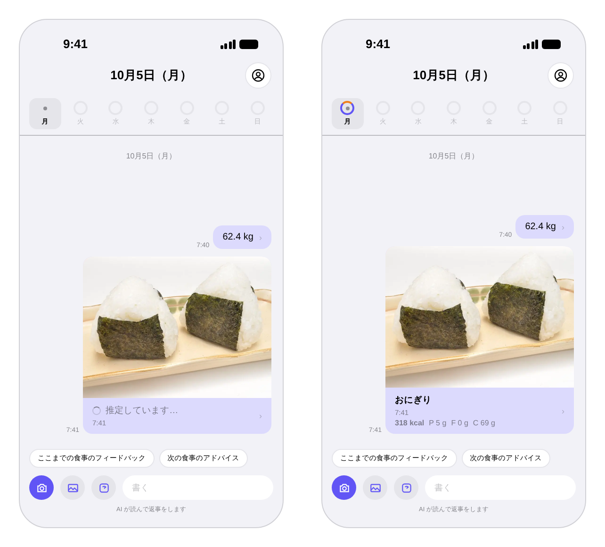

アプリに生成 AI を組み込むと、LLM の応答を待つ時間が生まれます。その待ちは、ストリーミングで少しずつ見せる、応答をキャッシュする、速いモデルに切り替える、ローディングの見せ方を工夫する、といった方法で手当てするのが定番です。

ただ、どの手当ても、待ちがあることを前提にしています。AI を通さなくてよい操作まで AI に通したり、端末で済む操作までサーバーの応答を待ったりしていれば、本来一瞬で終わるはずの操作に待ちが生まれます。私が個人で開発している iPhone の食事記録アプリ nu-tori でも、記録の操作を AI のエージェントに任せる設計を考えたことがあり、この理由でやめました。

では、生成 AI をアプリに組み込むとき、待ちをどう仕分ければよいのでしょうか。この記事では、手当てを考える前に、操作ごとに「待つ必要があるか」を問い直すことを提案します。操作ごとに、次の 3 つを上から順に問います。

1. AI を通さなくてよい操作は、通さない
2. 端末で済む操作は、サーバーを待たない
3. なくせない待ちは、待つ部分と止める操作を最小にする

nu-tori の設計を例に、順に説明します。

https://nu-tori.app/

nu-tori は写真で食事を記録し、体重の傾向から、その日に摂るカロリーの目安を調整する iPhone アプリです。設計の文書を含め、リポジトリも公開しています。

https://github.com/gn-t-k/nu-tori

## AI を通さなくてよい操作は、通さない

nu-tori には、写真から料理と栄養を推定する機能と、AI と会話する機能があります。AI が中心にあるアプリなので、記録の操作も AI に任せる形を考えました。記録を作る・直す・消す API を MCP（LLM が外のツールを呼ぶための決まった形）にして、端末は LLM のエージェントとだけやりとりする形です。

この形だと、体重を入れるたびに、料理の名前を直すたびに、LLM の 1 ターンを待つことになります。電波が悪ければ、そのたびに止まります。

LLM の応答待ちは、サーバーで計算したり DB を読んだりする待ちより、ずっと長くかかります。そして、縮めるのが難しい待ちです。ストリーミングで待ちの体感を減らしたり、モデルを切り替えたりキャッシュを使ったりして応答を速くする工夫はあります。それでも、そもそも待たせずに済むのが一番です。LLM の呼び出しは、かなり高価なものだと自覚して扱うべきだと考えています。

そこで nu-tori では、記録の操作を AI に通さないことにしました。記録は、端末とサーバーの同期で作り、直し、消します。会話の中で AI が記録の直し方を示すときも、AI は記録を直接直しません。ユーザーが直し方のボタンを押したときに、端末が、ユーザーが自分で直したときと同じ書き込みを作ります。AI は直し方を示すだけで、操作そのものは一瞬で終わります。

この判断は、ずっと変えないと決めたわけではありません。端末の中で動く LLM が、記録の操作を任せられるほど賢く、操作についてこられるほど速くなったら、考え直します。サーバーの LLM がいくら速くなっても、電波が悪ければ遅れるからです。

AI を通すかどうかの見分け方は、考えればわかることです。AI に判断させることで結果が変わりうる操作なら、待つ必要があります。判断することがない操作や、判断してもしなくても結果が変わらない操作は、AI に判断させる理由がありません。体重を入れる、料理の名前を直す、といった記録の操作は、ユーザーが決めた値をそのまま書くだけなので、後者です。避けたいのは、考えずに AI に通して待たせてしまうことです。自分のアプリで AI に通している操作を、一度この見方で見返してみてください。

## 端末で済む操作は、サーバーを待たない

AI を通さなくても、操作のたびにサーバーの応答を待っていれば、待ちは残ります。電波の弱い場所では、なおさらです。

### 楽観的更新を、アプリ全体の既定にする

nu-tori は、オフラインファーストで作っています。操作の結果は、その場で端末のキャッシュに当てて画面に出します。サーバーへの書き込みは送り待ちに入れて、裏で送ります。記録の正本はサーバーにありますが、ユーザーの操作はサーバーを待ちません。

オフラインファーストにしたのは、電波がないときにも使えるようにするためではありません。電波の強弱に左右されず、いつでもサクサク使えるようにするためです。

この判断を UI デザインの方針から決めた経緯は、前の記事に書きました。この記事では、サーバーを待たない形をアプリ全体に広げるために、何を決めたかを書きます。

https://zenn.dev/praha/articles/08568310684aa3

すぐに結果を見せて裏でサーバーと話す、という点では、楽観的更新と本質は同じです。どちらも、失敗したときにどうするかを考える必要があります。違いは範囲だと考えています。楽観的更新は、ボタンなど特定の UI ごとに使うかを選ぶものです。オフラインファーストは、アプリ全体の既定をそちらに倒して考えるものです。

### 端末には、ユーザーが不利益を被るものだけを置く

すべてを端末に置くわけではありません。nu-tori では、計算や判定の決めごとの正本はサーバーに置き、端末には、サーバーに置くと次のどれかでユーザーが不利益を被るものだけを置いています。

1. 電波がないと、自分の操作の結果が見えない
2. 操作についてくる速さが要る（サーバーとの往復の遅れが見える）
3. アプリが開かれていないとき、または電波がないときにも動く必要がある

「端末で計算したほうが実装が楽」「サーバーの負荷が減る」は、理由にしません。たとえば、その日に食べた量を 1 日の目安と比べる計算は、電波がなくても見せるために端末に置いています（1 つ目の条件）。

### 「もしこうなったら」を、既定のルールで決めておく

オフラインファーストを既定にすると、すべての操作に「もしこのときこうなったらどうする？」がつきまといます。送ったけれど結果が返ってこなかったら？　2 台の端末で同じ記録を直したら？　片方で消して、もう片方で直したら？　これを操作ごとに決めていくと、とても大変です。

nu-tori を設計してみて気づいたのは、既定のルールを先に決めておいたほうが楽だということです。nu-tori では、同期の決まりを 1 つの文書にまとめ、どの記録にも同じルールを当てています。ルールが先に決まっているから、操作ごとに考え込まずに、サーバーを待たない形をアプリ全体に広げられます。

| 起こりうること | 既定のルール |
| --- | --- |
| 送った書き込みの結果が返ってこない | 書き込みはすべて、書き込みの ID で冪等にする。結果を受け取るまで送り待ちに残し、送り直す |
| 2 台の端末で同じ記録を直した | サーバーがあとに受け取ったほうを採る。端末の時計には頼らない |
| 片方で消し、もう片方で直した | 削除を採る |
| サーバーが書き込みを受け付けなかった | 結果は受け付けた・受け付けなかったの 2 つに畳む。受け付けなかったら、サーバーが添えた今の値を、ふだん変更を取りに行くのと同じ道で当てる。記録の種類ごとに戻し方を持たない |
| 保存の途中でアプリが落ちた | 送り待ちを先に保存し、キャッシュをあとに保存する。残りうるのは「送り待ちはあるが、キャッシュに無い」だけで、送って取りに行けばそろう |

### 電波がないときと、2 台を並べて使うときの限界は受け入れる

既定のルールで割り切った分、受け入れている限界もあります。

- 目標を立てる、サインインする、アカウントを消す、の 3 つには電波が要る
- 2 台目で直したあとに、1 台目が電波のないあいだに直した古い分を送ると、古いほうが勝つ。2 台を並べて使うときだけに起きるので受け入れている
- 電波がないときに記録した体重で目標に届いても、「目標に届いた」の知らせは同期するまで出ない。記録そのものはすぐ見える

## なくせない待ちは、待つ部分と止める操作を最小にする

AI の待ちとサーバーの待ちをなくしても、なくせずに残る待ちがあります。写真から料理と栄養を推定するのは、AI を通すしかありません。目標を立てるときのように電波が要る操作や、まだサーバーに届いていない記録は、サーバーを待つしかありません。こうした残った待ちは、待つ部分をできるだけ小さくし、止める操作を絞っています。nu-tori でいちばん長い待ちである、写真からの推定を例に説明します。

### 待つ部分だけを、要素として切り出す

食事のカードは、写真、撮った時刻、料理の名前、栄養の要素に分けて描いています。写真と撮った時刻は端末にあるので、記録した瞬間に出ます。推定を待つのは、料理の名前の場所だけです。そこには料理の名前の代わりに「推定しています…」の 1 行と小さな回る印を置きます。kcal と P・F・C は、推定が済んでから出します。推定の結果は、ほかの記録と同じく同期で届き、名前と栄養の場所だけが埋まります。送ってから 60 秒までは 3 秒おきに取りに行き、そのあとはふだんの同期に任せます。

待ちの種類によって、見せ方も分けています。サーバーにまだ届いていない記録は、カード全体を薄く描き、届いたら濃くします。推定中であることは、名前の場所の 1 行で伝えます。どちらも、画面全体をふさがず、待っているもののその場に出します。

### 止める操作を、最小にする

推定を待つあいだ、止めるのは料理を足す・直す操作だけです。推定の結果とぶつかるからです。止めた操作は押せない表示にして、「推定が終わると足せます。」と理由を添えます。

撮った時刻を直す、食事を消す、といった操作は、推定中でも使えます。別の食事や体重を記録したり、ほかの画面に移ったりするのも止まりません。

## まとめ

生成 AI をアプリに組み込むとき、待ちの見せ方や縮め方を考える前に、その操作は待つ必要があるのかを問い直してみてください。

1. AI を通さなくてよい操作は、通さない。AI に判断させても結果が変わらない操作は、AI に通さない
2. 端末で済む操作は、サーバーを待たない。楽観的更新をアプリ全体の既定にし、「もしこうなったら」は既定のルールで決めておく
3. なくせない待ちは、待つ部分と止める操作を最小にする。待つ部分だけを要素として切り出す

自分のアプリの操作を 1 つずつ思い返してみると、なくせるローディングが見つかるかもしれません。

<!-- tech-article-state
## 成果物
### 企画
- スタートポイント: 個人開発者。アプリに AI を使った UI を組み込むことを考えているかもしれない。画面はサーバー（や LLM）の応答を待ってから更新する作りで、オフラインファーストを知らない可能性がある
- 懸念される出来事: （空。深追いしない）
- R1: 端末で済む操作までサーバーの応答を待ったり、LLM を通さなくてよい操作まで通したりして、本来一瞬で終わる操作に待ちが生まれている
- R2: 読者が自分のアプリの操作を「待たなくてよい（端末で済む）」「LLM の待ちが要るか疑う」「どうしても待つ（待つ部分を最小にする）」に仕分け、なくせる待ちを1つ以上挙げられる
- 読者がすでに試したこと: どんなローディング表示にするか悩む、細かなパフォーマンスチューニングをする、ストリームやモデルの切り替え、レスポンスのキャッシュで LLM の待ちを縮める（待ちがあること自体は疑っていない）
- 開発者の意図（2026-11-19〜20 に開発者が言ったもの）:
  - オフラインファーストにしたのは「電波がないときも使える」ためではなく、「電波の強弱に左右されず、いつでもサクサク使える」ため
  - 端末で済むものは、サーバーを待たない
  - 楽観的更新と本質は同じ（すぐ返して裏で仕事をし、失敗したときの扱いを考える）。違いは範囲で、楽観的更新は特定の UI ごとに選ぶもの、オフラインファーストはアプリ全体の既定にするもの
  - 記録の操作をエージェント経由にする案は、本来一瞬で終わる操作に不要な待ちが生まれるのでやめた。LLM の応答待ちはサーバーの応答待ちよりずっと長く、チューニングもしにくい。ストリームやモデル切り替え、キャッシュの工夫はあるが、待たせずに済むのが一番。高価なものとして扱う
  - なくせない待ち（写真からの推定）は操作を止めない。UI の要素を細かく分け、待たせる部分を最小にする
  - （2026-11-20）オフラインファーストにすると、すべての操作に「もしこのときこうなったら？」が大量につきまとい、決めるのがとても大変になる。だから競合は基本的に後勝ちにするなど、既定のルールを決めておくほうが楽。sync.md を作っているのがその答え。実際に設計してみて気づいたプラクティス
  - （2026-11-21）AI を通すかの見分け方は自明で、考えずに待たせるのをやめようという考え。AI に判断させることで結果が変わりうる操作は待つ必要があるが、判断することがない、または判断してもしなくても結果が変わらない操作は判断させない
- 扱い: エージェントの話は「アンチパターン」としてでなく、待ちを見直す例として出す（どれくらいの人がそうしているかの根拠は無いため）

### 構造
- 主題: 本来一瞬で終わる操作の待ちを、根本からなくす
- S: 個人開発のアプリは、サーバーや LLM の応答を待ってから画面を更新する作りが多い。待ちがあれば、ローディング表示を工夫したりチューニングしたりする
- C: それは待ちを前提にした手当てで、待たなくてよい操作まで待たせている
- Q: どの待ちならなくせるのか。どうやってなくすのか
- 主ポイント: 表示を工夫する前に、操作ごとに「待つ必要があるか」を問い直し、待ちを3つに仕分ける
- キーライン（分量の大半はオフラインファースト。2026-11-21 に順番を入れ替え、本文は 2 → 1 → 3 の順で書く。AI の待ち → サーバーの待ち → なくせない待ち）:
  - 1. 端末で済む操作は、サーバーを待たない。楽観的更新を1つずつ選ぶのでなく、アプリ全体の既定にする（オフラインファースト）
    - 何を端末に置くか（ADR-0011 の3条件）／nu-tori では正本はサーバー、操作は端末で済ませて送り待ちで送る
    - 気をつけていること: 既定にすると「もしこうなったら？」が操作の数だけ出る。既定のルールを先に決める（後勝ち、削除優先、受け付けた/受け付けなかったの2つ、冪等、送り待ちを先に保存）
    - 受け入れている限界（目標を立てる・サインインには電波が要る など）
  - 2. LLM を通さなくてよい操作は、通さない（記録の操作をエージェントに通す案をやめた。ADR-0023）
  - 3. なくせない待ちは、操作を止めずに最小にする（写真からの推定）
    - 食事のカードを要素に分け、写真と撮った時刻はすぐ出し、料理の名前と栄養だけを待たせる（MealCardView.swift、MealCardState.swift）。開発者の「UI の要素を細かく分け、待たせる部分を最小にする」考えで作ったものとして書いてよい（2026-11-20 確認）
    - 届いていない記録は全体を薄く、推定中は名前の場所の1行で、と2種類の待ちを分けて見せる（DESIGN.md:292-295）
    - 待つあいだ使えない操作（料理を足す・直す）だけを止めて理由を添える。時刻を直す・食事を消す、ほかの記録や画面の移動は止まらない（MealEditOffer、sync.md）
    - 推定の結果は同期で届く（送ってから60秒は3秒おきに取りに行く。EstimationFollowUp）
- 入れないもの: DESIGN.md:319（電波がないことを文で伝えない）。意図は「LLM が作るデザインは何でも補足の文で説明しがちなので、レイアウトで伝えて画面をすっきりさせる」で、主題から逸れるため
- 狙いワード（仮）: 主に「生成AI アプリ 組み込み」。補助は未定（「オフラインファースト」は答えとして出す言葉なので候補）。想定読者: アプリに生成 AI をどこに・どう組み込むかを考えている個人開発者。「オフラインファースト」（作り方を調べる人が多い）と「LLM レイテンシ」（作り終えて速くする段階の人で、待ちを疑う記事は読み飛ばされる）は外した。実際の語の形と検索数はこの環境から確かめられず、公開前に確かめる

### 導入
- SCQA 型: 標準型
- S: アプリに生成 AI を組み込むとき、LLM の応答には時間がかかる。その待ちは、ストリーミングやキャッシュ、モデルの切り替え、ローディングの見せ方で手当てするもの、と考えられている
- C: どの手当ても待ちがあることを前提にしている。AI を通さなくてよい操作まで通したり、端末で済む操作までサーバーを待ったりすれば、本来一瞬で終わる操作に待ちが生まれる。nu-tori でも記録の操作をエージェントに通す案を考えて、この理由でやめた（「多くの人がそうしている」とは書かない）
- Q: 生成 AI をアプリに組み込むとき、待ちをどう仕分ければよいのか（2026-11-21 検証の指摘で、3つ目のキーラインまで受けられる形に変えた）
- A: 手当てを考える前に、操作ごとに「待つ必要があるか」を問い直し、待ちを3つに仕分ける。AI を通さなくてよい操作は通さない。端末で済む操作はサーバーを待たない（オフラインファースト）。なくせない待ちは操作を止めずに小さくする
- 狙いワード「生成AI アプリ 組み込み」は S の冒頭に入れる

### 検証
- 最終実行日時: 2026-11-21
- 未対応の指摘: 1件（info: ADR-0011 の条件1と3の重なり。ADR の文を引いているので直さない）。2026-11-21 に残りの7件を直した。元の指摘: 8件（critical 0、warning 2、info 6）。warning は「AI を通さない」節に見分け方の基準がない（深さ不足）、なくせないサーバーの待ちが「受け入れている限界」と「なくせない待ち」の節に散っている（MECE）。info は導入の並び順の明示、疑問と3つ目のキーラインの対応、既定のルールの節のつなぎ、ポーリングの段落の置き場、ADR-0011 の条件1と3の重なり、見出しの意味の弱さ

## 履歴
- 2026-11-19 企画 開始。nu-tori の ADR（0001・0008・0009・0011・0013・0014・0022・0023）と同期の文書を読んだ
- 2026-11-19 企画 開発者の回答を反映。狙いは「オフラインでも使える」から「ローディングをなくす」に移した
- 2026-11-20 企画 完了。楽観的更新との違いは「範囲（アプリ全体の既定か）」とし、待ちを3つに仕分ける R2 にした
- 2026-11-20 構造 完了。待ちを3つに仕分けるキーラインにし、気をつけていることは1の下に置いた。3の例は nu-tori の食事のカードを調べて決めた。狙いワードを仮決めした
- 2026-11-21 構造 狙いワードを見直した。読者の段階を「組み込む前（どこに AI を使うか）」に合わせ、主に「生成AI アプリ 組み込み」を狙う
- 2026-11-21 導入 完了。標準型。読者を組み込む前の人に合わせ、AI の待ちから入るようキーラインを 2 → 1 → 3 の順に入れ替えた
- 2026-11-21 本文 下書きを書いた。根拠を確かめていない箇所は TODO のコメントで残した
- 2026-11-21 検証 validator を初めて実行。critical 0、warning 2、info 6
- 2026-11-21 検証 指摘を反映。AI を通すかの見分け方を開発者の答えで足し、3つ目のキーラインを「待つ部分と止める操作を最小にする」にした
-->
